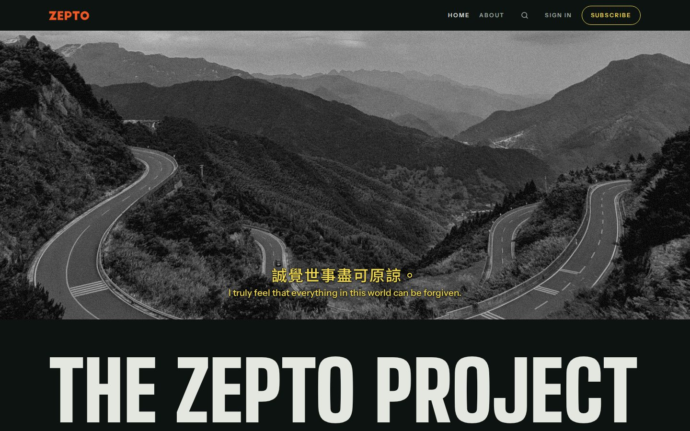
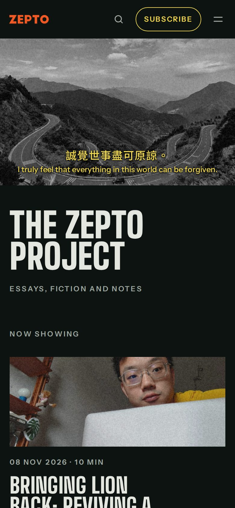
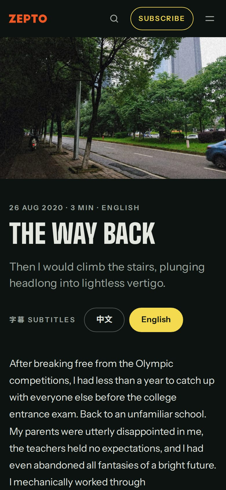
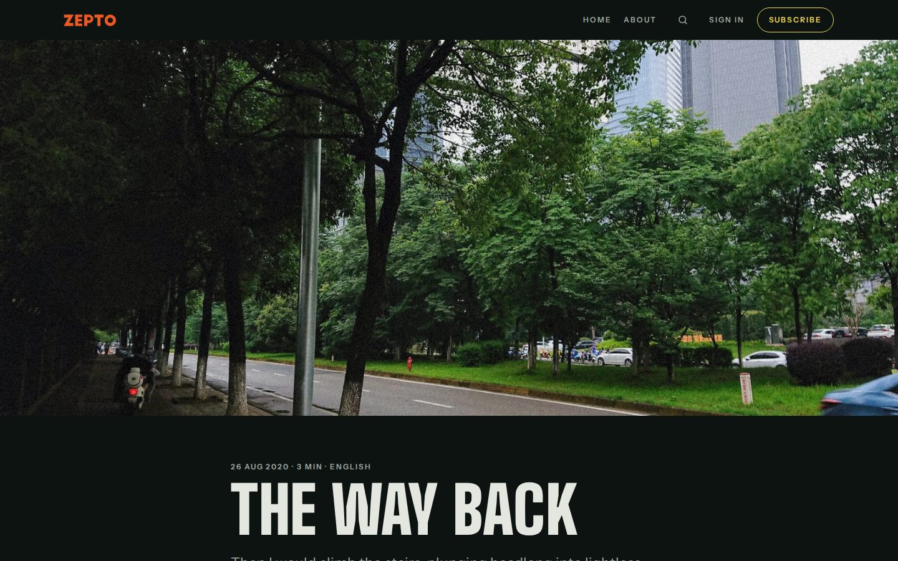
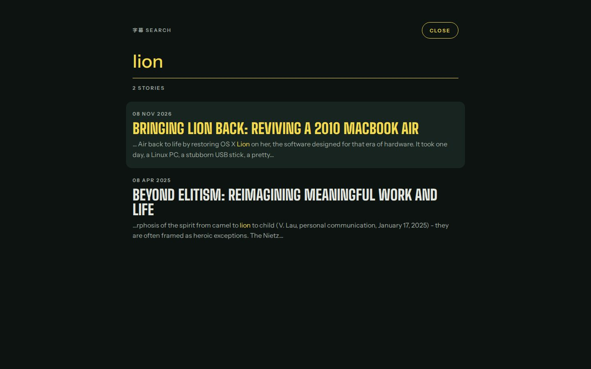
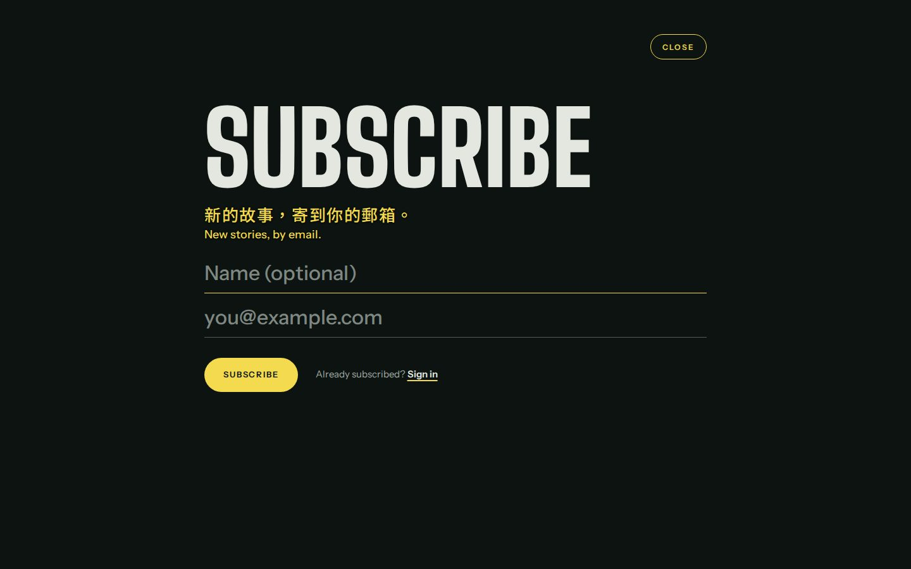

# Night Edition 夜行

A Ghost theme in the language of Hong Kong film stills. Photos are letterboxed like frames from a film, captions run as yellow subtitles, post titles are title cards, headings carry scene numbers, and every story ends on 「完」. A post can switch between 中文 and English the way a film switches subtitle tracks.



<p>


</p>



## Features

- Feature images letterboxed at 2.39:1, with portrait images pillarboxed
- Captions set as subtitles, with film grain over photos
- A home-page title card that fills one line of the screen
- Numbered scenes for headings and an end card on every story
- Full-screen search, subscribe and sign-in, typed like subtitles
- Bilingual 中文 / English posts with per-language reading time
- A full-screen menu on phones

## Install

1. Download `night-edition-1.0.0.zip` from the [latest release](https://github.com/XGZepto/night-edition/releases/latest).
2. In Ghost Admin, go to **Settings → Design & branding → Change theme → Upload theme** and choose the zip.
3. Activate it.

Requires Ghost 6.0 or later. Fonts load from Google Fonts.

## Writing for this theme

**Bilingual posts.** Write the Chinese version, insert a divider (the `---` card), then write the English version, and add the internal tag `#bilingual`. Readers get a 字幕 Subtitles (中文 / English) switch and their choice is remembered; reading time is recalculated for the language they read. Without JavaScript, and in email and RSS, the post reads in full exactly as written. A first paragraph reading "(English version follows)" is hidden automatically.

**Simplified Chinese.** Tag a post `#zh-hans` to set it in Simplified character forms. Other Chinese text is detected automatically and set in Traditional forms.

**Chinese emphasis.** Italic Chinese is set in Chiron Hei HK italic.

**Featured posts** (Ghost's "Feature this post") run full width in the post grid, as does the newest post on the home page.

**Image widths** follow the editor: regular images sit in the text column, Wide images extend to 1000px, Full images run edge to edge.

**The home page** plays your site description as a subtitle over the cover image (Settings → General), then the title card. Without a cover image the description plays on a black frame.

## Search, sign-in and subscribe

- **Search** reads your posts through the Content API (with the RSS feed as a fallback) and searches titles, tags, excerpts and full text. Chinese is matched anywhere in the text; English matches at the start of words. Press `/` to open it.
- **Sign-in and subscribe** send Ghost's usual magic link. Ghost's own links, such as `#/portal/signup` in your navigation or the sign-in button in the comments box, open the theme's version too, and the confirmation after a magic link is shown in the theme's style.
- **Your membership settings decide what readers see.** On a site with free signup, Subscribe opens the theme's form. On sites with paid tiers, or where signup requires agreeing to terms, Subscribe opens Ghost's Portal so readers can choose a plan or accept the terms. On invite-only sites only Sign in is shown. The member account page uses Portal, and Portal's floating button is hidden.

<p> </p>

## Theme settings

In Ghost Admin → Settings → Design & branding → Theme:

| Setting | What it does |
| --- | --- |
| Hero subtitle | A second subtitle line under the site description, over the cover image |
| Title card credits | The line under the site title on the home page |
| Default language | Which half a `#bilingual` post opens on: the reader's browser language, 中文 or English |
| Film grain | Grain over photos |

Custom fonts chosen in Ghost Admin (Settings → Design & branding → Brand) replace the theme's heading and body faces.

## Development

```bash
pnpm install
pnpm test      # gscan, Ghost's theme validator
pnpm zip       # dist/night-edition-<version>.zip, ready to upload
```

To work against a local Ghost, link this folder into its themes directory and activate it:

```bash
ln -s "$PWD" /path/to/ghost/content/themes/night-edition
```

`assets/css/screen.css` and the scripts in `assets/js/` are served as written. Search and the sign-in dialog run from `search.js` and `members.js`; how they look is set in `main.js`, the partials and the CSS.

## Credits

Typefaces from Google Fonts, all under the SIL Open Font License: Big Shoulders, Instrument Sans, JetBrains Mono, Noto Sans TC, Noto Sans SC and Chiron Hei HK. Built for [Ghost](https://ghost.org).

## License

[MIT](LICENSE)
